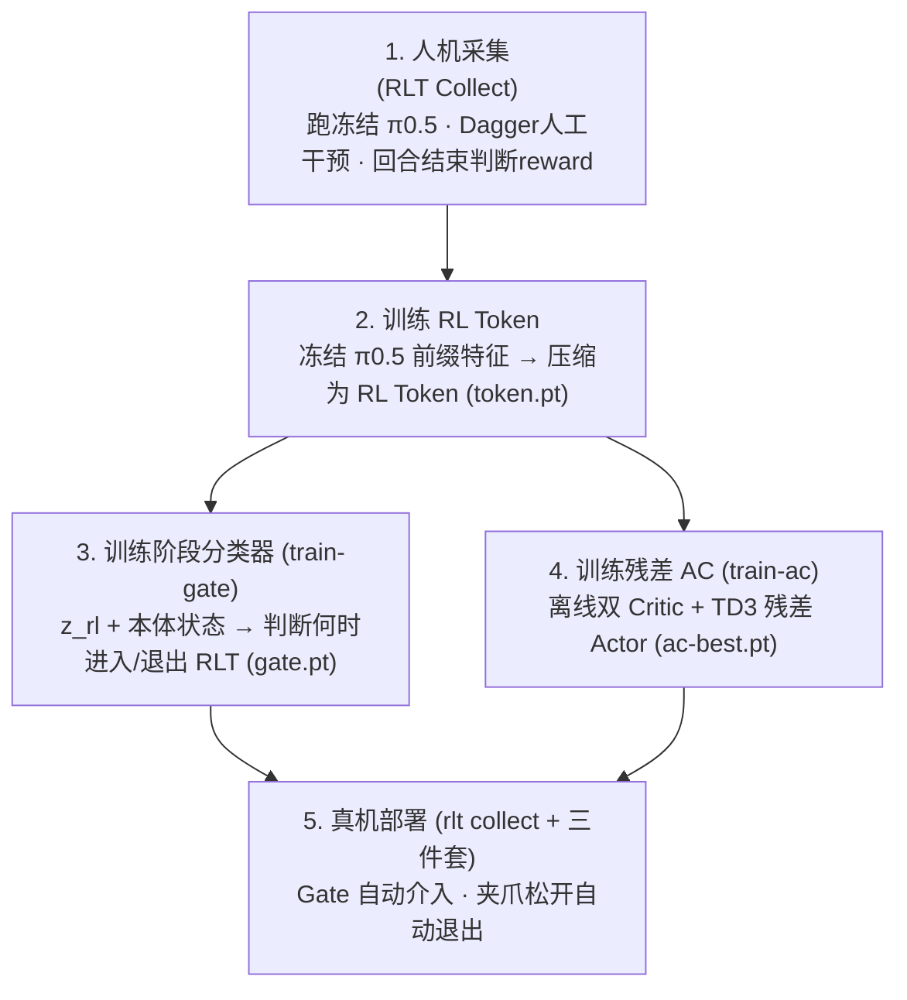
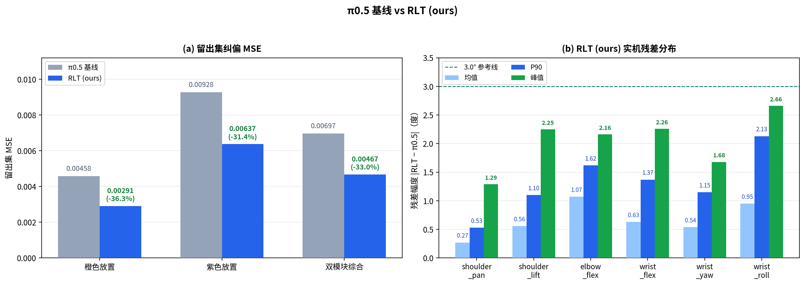
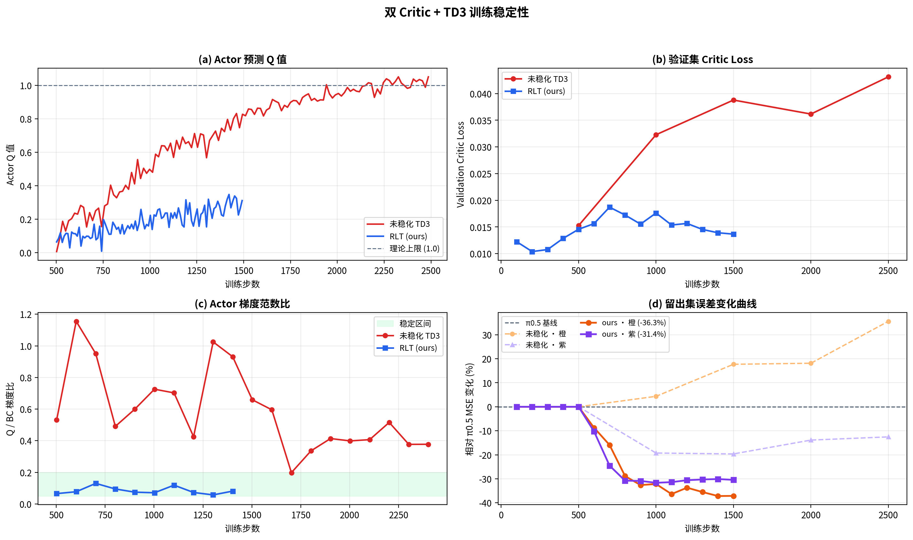
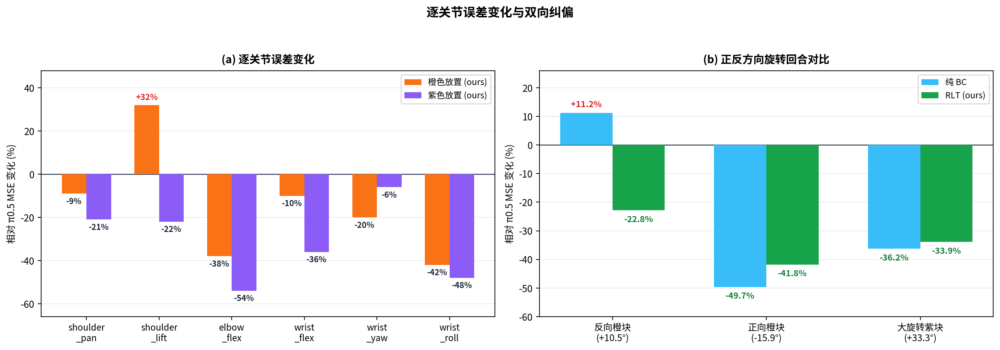
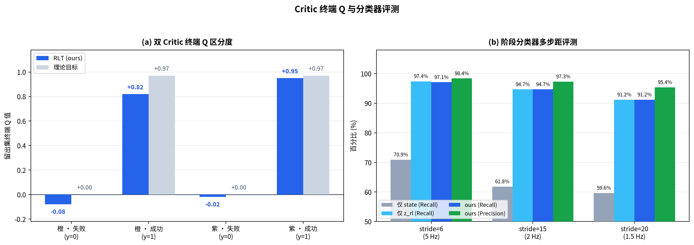
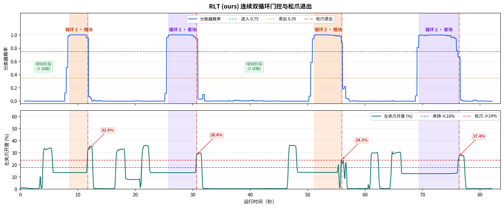

<h1 align="center">AlohaMini-RL-Token</h1>

<p align="center">
  <b>基于 AlohaMini 双臂平台的 RL Token + 残差 Actor-Critic 复现教程及参考</b><br>
  <sub>人机采集 · RL Token 训练 · 阶段分类器 Gate · 离线双 Critic AC · 夹爪兜底退出 · 真机部署</sub>
</p>

<p align="center">
  
  
  
  
  
  
</p>

<details>
<summary>目录</summary>

- [一、整体流程](#一整体流程)
- [二、快速上手：从采数据到上机](#二快速上手从采数据到上机)
  - [步骤 1：边推理边采集与人工纠偏](#步骤-1边推理边采集与人工纠偏)
  - [步骤 2：训练 RL Token](#步骤-2训练-rl-token)
  - [步骤 3：训练关键阶段分类器（Gate）](#步骤-3训练关键阶段分类器gate)
  - [步骤 4：离线训练残差 Actor–Critic](#步骤-4离线训练残差-actorcritic)
  - [步骤 5：上机闭环推理](#步骤-5上机闭环推理)
- [三、实验结果与参考图表（π0.5 基线 vs ours）](#三实验结果与参考图表π05-基线-vs-ours)
  - [3.1 总体效果对比](#31-总体效果对比)
  - [3.2 双 Critic 训练稳定性与双向纠偏](#32-双-critic-训练稳定性与双向纠偏)
  - [3.3 阶段分类器与夹爪松开兜底退出](#33-阶段分类器与夹爪松开兜底退出)
  - [3.4 真机同条件成功率对照](#34-真机同条件成功率对照)
- [四、复现关键经验与避坑总结](#四复现关键经验与避坑总结)
- [五、常见问题（FAQ）](#五常见问题faq)

</details>

---

## 一、整体流程

RLT 的核心思路是在**冻结 $\pi_{0.5}$ 基座**的前提下，把 VLM 视觉特征压缩为一个紧凑的 **RL Token**，仅在精细对槽的关键阶段切入轻量级**残差 Actor–Critic** 对 $\pi_{0.5}$ 动作做小幅修正，完成放置后由**分类器 + 夹爪张大规则兜底**切回 $\pi_{0.5}$。

以七巧板模块连续放置任务为例（绿块 → 橙块 → 紫块），$\pi_{0.5}$ 本身已能稳定完成绿块放置与搬运，RLT 在一轮任务中**介入两次**，分别负责橙块与紫块的最终对准放置。相比于 **$\pi_{0.5}$ base**，成功率得到大幅提升。



---

## 二、快速上手：从采数据到上机

以下示例均使用占位路径，实际运行时替换为你的本地目录与设备即可。

```bash
conda activate alohamini_rlt
cd <REPO_DIR>
export PYTHONPATH="$PWD/src"
```

### 步骤 1：边推理边采集与人工纠偏

启动后由冻结 $\pi_{0.5}$ 自动执行，观察到即将失败时按 `h` 人工接管；回合结束按右箭头回位，输入 `1` / `0` 回车提交评分。已提交回合会在后台自动导出为 `lerobot_v3` 格式。

```bash
python -m alohamini rlt collect \
  --host <HOST_IP> \
  --robot_model alohamini2pro \
  --policy.path <PI05_CKPT> \
  --task "<TASK_PROMPT>" \
  --device cuda --fps 30 --policy.n_action_steps 15 \
  --fixed-dimensions arm_right lift_axis \
  --left-port <LEADER_PORT> \
  --leader-id <LEADER_ID> \
  --calibration-dir <CAL_DIR> \
  --output-dir <DATA_DIR> 
```

| 按键 | 功能 |
|---|---|
| `h` | 人工接管（从臂跟随主臂相对位移）|
| `c` | 手动区分 RLT 阶段 |
| `Space` | 暂停 / 继续 |
| `→` | 结束本回合、保存终点并自动回起点 |
| `reward` + `回车` | 提交成功 / 失败评分并自动进入下一回合 |
| `q` | 退出并等待后台视频导出完成 |

### 步骤 2：训练 RL Token

在冻结 $\pi_{0.5}$ 的视觉前缀特征上训练编码器与解码器，将多视角视觉特征压缩为 `2048d` 的 `z_rl`。

```bash
python -m alohamini rlt train-token \
  --config <TOKEN_CONFIG_JSON> \
  --output-dir <TOKEN_OUT_DIR>
```


### 步骤 3：训练关键阶段分类器（Gate）

准备放置区间的帧边界标注 JSON（`rlt-placement-intervals.json`，记录每条回合的关键段 `[start_frame, end_frame_exclusive)`），复用冻结 `token.pt` 与本体状态训练轻量 MLP 二分类器：

```bash
python -m alohamini rlt train-gate \
  --config <COLLECT_CONFIG_JSON> \
  --dataset <DATA_DIR>/lerobot_v3 \
  --intervals <INTERVALS_JSON> \
  --token-checkpoint <TOKEN_PT> \
  --validation-fraction 0.24 --gate-eval-stride 20 \
  --output-dir <GATE_OUT_DIR>
```

训练按完整回合切分训练 / 选权 / 留出验证集，并输出多投票步距下的误入率与漏检率，保存 `gate.pt`。

### 步骤 4：离线训练残差 Actor–Critic

基于已评分的采集数据离线训练双 Critic + TD3 残差 Actor：

```bash
python -m alohamini rlt train-ac \
  --config <COLLECT_CONFIG_JSON> \
  --dataset <DATA_DIR>/lerobot_v3 \
  --token-checkpoint <TOKEN_PT> \
  --ac-steps 5000 --ac-batch-size 64 --replay-stride 15 \
  --output-dir <AC_OUT_DIR>
```

### 步骤 5：上机闭环推理

同时加载 `token.pt`、`ac-best.pt` 与 `gate.pt`。系统默认启用**夹爪松开兜底退出**（先确认夹持 ≤18%，再连续 3 帧实测开度 ≥24% 即立刻退出 RLT 并交还 $\pi_{0.5}$）：

```bash
python -m alohamini rlt collect \
  --host <HOST_IP> \
  --robot_model alohamini2pro \
  --policy.path <PI05_CKPT> \
  --task "<TASK_PROMPT>" \
  --device cuda --fps 30 --policy.n_action_steps 15 \
  --fixed-dimensions arm_right lift_axis \
  --left-port <LEADER_PORT> \
  --leader-id <LEADER_ID> \
  --calibration-dir <CAL_DIR> \
  --token-checkpoint <TOKEN_PT> \
  --actor-checkpoint <AC_PT> \
  --gate-checkpoint <GATE_PT> \
  --output-dir <DEPLOY_OUT_DIR>
```

---

## 三、实验结果与参考图表（π0.5 基线 vs ours）

### 3.1 总体效果对比

| 模型 | 橙色放置 MSE | 紫色放置 MSE | 双模块综合 MSE | 真机单步大臂峰值 | 双 Critic 留出表现 |
|---|---:|---:|---:|---:|---|
| **$\pi_{0.5}$ 基线** | `0.00458` | `0.00928` | `0.00697` | — | — |
| **RLT (`ours`)** | **`0.00291` (-36.3%)** | **`0.00637` (-31.4%)** | **`0.00467` (-33.0%)** | **`≤2.26°`** *(18,371 帧)* | `val_q_loss=0.0137`，`actor_q=0.24`，橙色人工替换偏好率 **`74.0%`** |



### 3.2 双 Critic 训练稳定性与双向纠偏

未稳化 TD3 采用 2 层 Transformer 的 Encoder 和 Decoder 得到 512 维 RL Token，ours 采用 4 层 Transformer 的 Encoder 和 Decoder 得到 2048 维 RL Token。

- **训练曲线收敛**：控制 Q 梯度远小于 BC 梯度并加入权重衰减与 token 噪声后，`actor_q` 稳定在 `0.20~0.25` 区间，不再出现早期离线 TD3 的 Q 值爆表与过拟合回弹。
- **按视觉方向双向纠偏**：在起始位姿接近、但需要相反旋转方向的留出回合上，`ours` 能根据当前腕部画面分别朝正/反方向给出正确修正，紫色全部 6 个手臂关节同步改善，`wrist_roll` 误差下降 `-42% ~ -48%`。





### 3.3 阶段分类器与夹爪松开兜底退出

- **离线多步距留出评测**：在 `stride = 6 / 15 / 20` 帧下，分类器 Precision 为 `98.4% / 97.3% / 95.4%`，Recall 为 `97.1% / 94.7% / 91.2%`，绿色阶段与非关键区间均保持 **0 误触发**。
- **真机连续双循环实测**：下图中绿色阶段概率全程接近 0，橙/紫进入对槽时概率拉升至 `~0.99` 切入 RLT，每次松爪开度跨过 `24%` 即刻由夹爪规则兜底退出，并在重新夹持前阻断重复进入。





### 3.4 真机同条件成功率对照

在同摆位、零人工接管条件下，两组各运行 10 轮真机 A/B 对照测试结果如下：

| 模型 | 绿块成功率 | 橙块成功率 | 紫块成功率 | 总成功率 |
|---|---:|---:|---:|---:|
| **$\pi_{0.5}$ 基线** | `10/10` | `4/10` | `4/10` | `3/10 (30%)` |
| **RLT (`ours`)** | **`10/10`** | **`9/10`** | **`10/10`** | **`9/10 (90%)`** |


---

## 四、复现关键经验与避坑总结

1. **`z_rl`、`robot state`、`ref action` 拼接前先做投影对齐**
   不同模态的维度和数值尺度差异很大，直接 `concat` 会导致高维视觉特征淹没低维本体状态和动作信息。拼接前务必各自经过一层投影（例如 `LayerNorm + Linear`）统一到相近尺度与维度，再输入 Actor / Critic / Gate。
2. **DAgger / 人工介入要“早介入、不混失败恢复数据”**
   采集纠偏数据时，只要看到机械臂出现偏槽趋势、快要失败就立刻人工介入，**不要把已经明显失败、撞歪或掉块后的强行补救动作混进训练集**，否则训出来的策略动作会非常抖。
3. **RLT 的 Q 权重不要设太大，BC 权重可略大**
   离线或小样本微调阶段，Q 项权重通常控制在 `0.1 ~ 1`，**BC loss 的权重可以略微大一些**。核心是避免 Q 梯度盖过 BC 梯度引发 OOD 过估计和动作漂移。


---

## 五、常见问题（FAQ）

**1. Q：分类器判断介入时机的误判率大概多少？如果已经对准了却被判成“该介入”，RLT 的残差会不会反而把 VLA 的精度破坏掉？**

**A**：我们在数据标注阶段就针对边界做了冗余处理，退出判定也叠加了夹爪开度规则兜底。单独实测约 20 次判定都非常准确，总体来说这个轻量 MLP 分类器非常好训。即使在已经对准的状态下进入 RLT，零初始化且带逐轴限幅的残差网络给出的修正量本身也很小，不会破坏原本已经对准的 VLA 精度。

**2. Q：RLT 参与的部分有哪些？一轮任务里 RLT 可以介入好几次吗？**

**A**：本任务中 RLT 介入两次（分别在橙色和紫色模块放置对槽时介入，绿色模块与搬运过程由纯 $\pi_{0.5}$ 完成）。目前业界常见做法都是单次介入，实测下来多次介入在训练难度上会稍微高一点（需要同一套表征和网络兼顾多个目标阶段的视觉差异与起止切换），配合一个训练较好的阶段分类器和退出兜底机制可以实现稳定的多次介入。

**3. Q：RL Token 的重建 Loss 降到多少算正常？**

**A**：在 $\pi_{0.5}$ 上一般降到 **`0.1` 左右**比较正常。不同基座模型、不同相机视角数量以及不同的 Encoder/Decoder 结构会导致绝对 Loss 存在差异，建议同时核对留出集上的打乱消融差距和余弦相似度，确保视觉信息真正压进了 `z_rl` 而没有发生坍缩。

**4. Q：RL Token 的 Encoder 和 Decoder 是怎么设计的？**

**A**：采用 **4 层 Transformer 的 Encoder 和 Decoder 得到 2048 维 RL Token**。之前用 2 层 Transformer 的 Encoder 和 Decoder 得到 512 维 RL Token 效果很差。原因可能是任务长程，2 层 Transformer 难以把所有信息压缩到 512 维的 token 里，修改后效果好很多。
